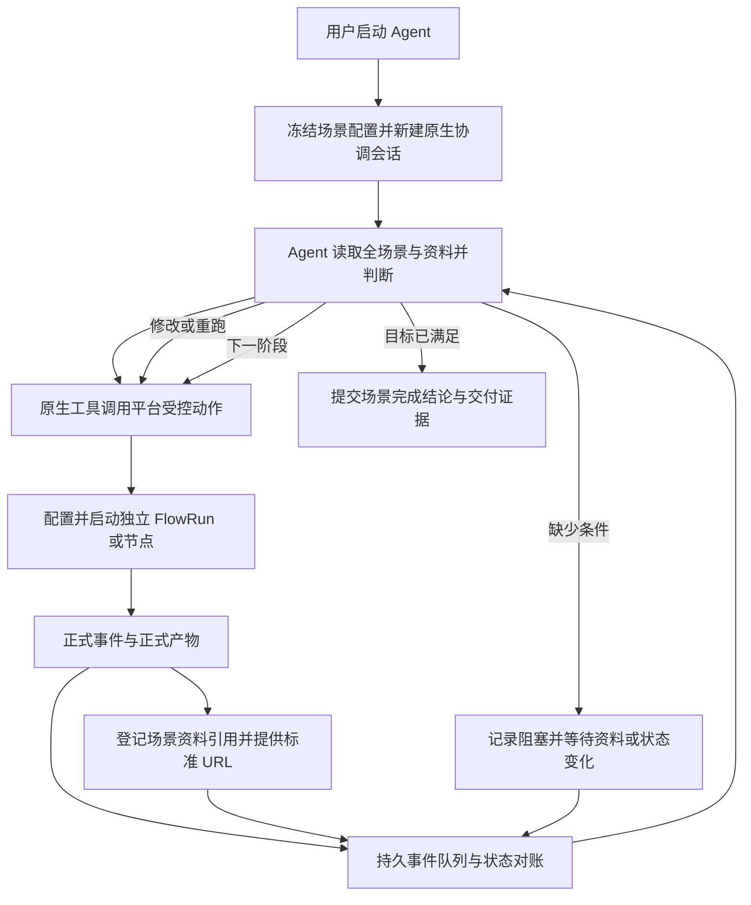

# 场景空间：使用链路、实现现状与能力缺口

核对日期：2026-10-28。源码基线：`cce531c6822a4cb43302b2f65a9a8092e7965d86`。
本文是现状审计与后续实施设计，不表示下面的待实现能力已经交付。

实施进度：CASE-01已完成动作结果、显式关联重试、暂停门禁和HTTP失败审计持久化，
66项定向回归通过；已有启动事实但结果不确定时明确拒绝重复启动，完整恢复待后续切片。
下文第4节保留初次审计的原问题取证；工具／事件／产物资料闭环尚未交付。
CASE-02已完成新协调轮次、配置／上下文快照、持久Worker原生bootstrap与幂等重试，
历史会话保留可打开；工具、事件回访及跨容器产物回流仍未交付。
CASE-03A已接入正式只读 MCP：新协调会话可查询当前场景概览、阶段路径与资料引用，
凭据按当前轮次／binding／Runtime／目录版本及用户重新授权。CASE-03按验收边界拆为
03A（注册与读取）及03B（流程图／草稿与配置、启动）。CASE-03B已交付独立原生流程
MCP及当前副本的配置、复制与启动动作。CASE-04已交付正式输出资料登记、独立冻结的资料
MCP及标准产物URL的受限读取；本地固定源码Runtime容器读取和哈希验收通过。下一切片
为CASE-05B，唯一实施状态以`flowrun-runtime-task-progress.md`为准。CASE-05A已完成流程关键
事件的事务性持久入队；后台原生消息回访和自主复核仍未交付。

## 1. 产品目标：由场景 Agent 代替人运行和监控流程

2026-10-28 用户补充的四点要求是本文目标设计的依据，覆盖初稿中“启动直接触发首阶段、
条件满足后由平台直接推进下一阶段”的建议。现有代码审计结论保留，下面的目标能力仍待实现。

场景是具有明确目标、流程路径、资料和会话配置的 Agent 工作空间。用户点击启动后，
像 Agent 定时任务的一次新运行一样创建一个原生 Agent 会话，继承场景配置并获得全局信息。
由该 Agent 判断当前资料是否足够、启动哪个流程／节点、是否补充或修改配置、是否重跑、
何时进入下一流程、何时目标达成；流程产生的重要事件持续反馈到同一协调会话。

职责分配：

- 场景 Agent 负责业务判断、资料选择、节点配置、质量复核、重跑与下一步决策。
- FlowWeave 负责提供可调用的业务工具、校验技术前置条件和权限、持久投递事件、治理资料引用、
  执行已获授权的动作和记录审计；不能用固定阶段顺序替代 Agent 的业务判断。
- OpenHands 正式类型、API、工具和事件生命周期承载 Agent 推理与会话执行。
- 既有 FlowRun 服务负责实际节点执行、快照、门禁、产物和正式验收；不另建流程执行器。
- 前端展示当前事实、判断理由、结果及用户接管入口；浏览器关闭后后台协调继续工作。

默认在场景既有授权内自主执行，不要求人对每次配置、启动、验收或重跑逐项确认。
资料缺失且 Agent 无法自行取得、权限不足、预算耗尽或用户明确暂停时，才停在可解释的阻塞状态。
已执行历史和原模板保持不可变；Agent 的调整落在受控执行副本及正式新版本／新尝试上。

## 2. 当前实际可用的链路

1. 创建场景：保存名称、工作区选择、说明和目标，同时创建场景专属协调目录。
   这些基础字段创建后固定；资料可以随后添加、上传、预览、重命名和移除。
2. 添加有序阶段：前端从当前运行且可写的 FlowRun 中选择完整配置的逐步／连续记录，
   支持拖动和键盘调序。后台校验记录可用性；保存路径会把首个阶段设为 ACTIVE。
3. 保存 Agent 配置：校验供应商、模型、思考程度、能力版本及认证。
4. 点击“启动 Agent”：后台重新校验完整路径和已保存配置，预留新协调轮次并冻结上下文；
   Worker在专属目录创建OpenHands原生会话并发送首条任务，完成后页面打开。
   已有会话使用“打开 Agent”，明确的新轮次另建会话，旧轮次保留；失败重试复用原身份。
5. 阶段卡片的“手动启动”：先复制模板，再启动当前副本；模板本身不启动。
6. 逐步节点被正式接受后，已有逻辑会尝试启动直接前驱均已接受、且已有草稿的后继节点。
   这里仍依赖正式接受；不能把节点 Agent 回复完成当作已接受。
7. 当前执行 FlowRun COMPLETED 后，回写当前阶段 COMPLETED，并将下一阶段设为 ACTIVE；
   最后阶段完成时把 Case 设为 COMPLETED。当前执行被取消时将 Case 设为 PAUSED。

当前与产品目标的差距：第 4 步尚未给会话提供完整的默认操作与事件回访闭环，
不能保证 Agent 能接着完成第 5 步。第 6 步的后继自动启动和第 7 步的阶段状态自动切换
也需要调整：应先向 Agent 反馈结果，由它判断重跑、修改或继续，不能抢先消耗复核窗口。
单个 FlowRun 的执行完成不直接等同于场景阶段业务完成。

## 3. 前后端能力对应与差距

| 环节 | 前端现状 | 后台现状 | 后续需要 |
| --- | --- | --- | --- |
| 基础配置 | 场景信息、资料、Agent 配置已存在 | 基础字段不可变、资料边界、版本锁、用户隔离已存在 | 保留边界，向协调会话提供完整场景快照与可刷新的最新资料 |
| 启动会话 | “启动 Agent”，已有会话改为打开 | CASE-02已提供持久轮次、配置／场景快照、后台原生bootstrap及历史入口 | 原生工具与事件回访仍需后续切片 |
| 启动判断 | 阶段有“手动启动” | 复制／启动 API 和模板就绪检查已存在 | Agent 查询输入契约、读取资料、配置本次输入；平台返回技术就绪问题而不替 Agent 决定 |
| Agent 操作 | 通用工作台，原有手动流程配置入口 | CASE-03A已有正式场景读取MCP；写操作仍只有局部作用域、plan、decision服务 | 默认装配正式原生工具，覆盖查询、草稿、端口、配置、启动、复核、重跑和停止 |
| 观察与回访 | 当前页面每 3 秒读取详情 | 产物创建 OBSERVE，完成／失败事件创建 REVIEW | Worker 持久消费，正式会话投递及对账；忙时排队／合并，空闲时唤醒 |
| 逐步复核 | 去执行记录手动处理 | 前驱接受后会直接尝试后继 | 节点完成先由 Agent 复核，支持修改／重跑／正式接受，再决定是否启动后继 |
| 跨阶段决策 | 下一卡显示活动，可手动启动 | FlowRun 完成直接完成当前阶段并激活下一阶段 | 先进入待 Agent 复核投影，Agent 决定重跑本阶段、调整后续、启动下一阶段或结束 |
| 产物回流 | 有场景资料和流程产物两个入口 | 当前资料 FILE 读取限 Case 上传目录；有标准产物内容 URL | 自动登记所有正式节点产物为场景引用，区分候选／已接受；链接原样可用，文件经授权的标准 URL 可读 |
| 配置调整 | 有逐步草稿、端口和运行配置界面 | 草稿、未启动端口、重跑与复制服务已存在但未形成 Case 工具全集 | Agent 可改本次输入输出、提示词、上下文、能力、认证和模型预设；保持正式版本与旧历史 |
| 异常处理 | 通用错误，次要操作记录 | 失败码、retry API与部分修复分支 | 结果准确、重试有界，重跑后重新绑定当前执行并继续反馈事件 |
| 暂停与终止 | 无完整场景级控制闭环 | PAUSED 未被所有入口一致拦截 | 场景协调暂停、当前流程停止与会话中断分别定义；恢复时对账，禁止重复启动 |
| 运行概览 | 路径为主体，会话单独打开 | 详情携带执行与审计 | 路径展示“Agent 判断中／执行中／待复核／阻塞”，直接查看判断及本轮资料来源 |

## 4. 已定位的关键实现问题

### 4.1 协调会话缺少默认能力与事件回访闭环

`create_case_control_conversation` 只传入用户选择的 capability_version_ids 和初始任务；
当前仓库内未找到为 Case 自动装配受控操作工具的注册／配置链路。CLI 有通用 API
请求能力，但没有专用 Case 命令，也不能据此证明每个 Case Runtime 都具备正确工具、
认证和当前 binding 的最小授权。外部人为配置的能力不在本次本地取证范围内。

`project_case_observations` 和 `project_flow_run_event` 会创建 CaseAgentTask，
但后台 HANDLERS 中没有 Case 消费器，仓库内也未找到这些任务从 PENDING 到
RUNNING／SUCCEEDED 的处理链。case.toml 投影阶段与计划摘要，没有把这些任务和
产物证据完整投递到协调会话。Agent 首轮结束后，不能保证被正式新结果再次唤醒。

### 4.2 跨阶段只回写状态，缺少 Agent 复核与决策

`reconcile_case_execution_state` 把下一阶段置为 ACTIVE，但不调用副本创建／启动。
隔离诊断验证：阶段一完成后阶段二为 ACTIVE，current_execution_flow_run_id 仍为空，
启动调用次数为零。它提供状态投影，没有将结果可靠交给 Agent 决策。
后续应补齐 Agent 复核与受控动作链，不能简单在这里追加一个自动启动下一阶段的调用。

### 4.3 启动失败重试可能误报成功

`start_case_stage_execution` 发现同 stage/run 的既有 proposal 后直接返回，未区分其
FAILED 状态；`execute_case_control_plan` 取得返回值后直接把计划设为 SUCCEEDED。

隔离诊断复现：已有 FAILED 的 START_STAGE_EXECUTION 时，新 START_EXECUTION 计划
最终为 SUCCEEDED，其 result.decision.state 却为 FAILED，原 FlowRun 保持 DRAFT，
实际 start_automatic_run 调用次数为零。单纯创建 retry plan 不能解决这个问题。

需要统一“命令受理、动作成功、运行开始、业务完成”的成功语义，重试使用新的可追溯
尝试，并按既有运行事实确认效果，不能把返回了响应当作成功。

### 4.4 暂停尚未成为全局执行门禁

`advance_case_stepwise_execution` 以及多个受控动作只排除 COMPLETED／ARCHIVED，
没有拒绝 PAUSED。隔离诊断复现：Case PAUSED、阶段 ACTIVE、前驱 ACCEPTED 时仍
创建并尝试分发后继启动计划。

另外，当前取消执行会把 Case 置为 PAUSED，但被 CANCELLED 的 FlowRun 是终态，
不能通过把场景状态改回 ACTIVE 来恢复原执行。必须分别定义“停止自动推进”、
“中断原生会话”和“终止本轮执行”的作用及恢复方式。

### 4.5 动作声明、API 与分发能力不完全一致

- CaseControlPlan 模型声明了 RERUN_STEPWISE_NODE／REVISE_UNSTARTED_RUNTIME。
- API 写入允许 RERUN_STEPWISE_NODE，但 plan dispatcher 尚未分发它；
  REVISE_UNSTARTED_RUNTIME 也没有对应的完整外部写入与分发路径。
- 独立 decision 分支可以复制逐步节点和连续运行草稿，但不是完整的修复后再次启动闭环。
- 连续运行复制只增加 CaseFlowRun 关联，没有自动替换阶段的 current_execution_flow_run_id；
  后续当前执行校验会限制操作新副本，需要显式受控的切换与历史保留设计。
- suggestion 路径只创建计划，既不自动执行，也不自动完成下一步决策；目前还拒绝
  通过 suggestion 请求逐步后继与重跑，不能把枚举中的动作都视为 Agent 可用能力。

### 4.6 顺序、成功条件与恢复可靠性需要收口

- 当前阶段顺序可在未终结 Case 中调整；缺少已执行阶段冻结和运行中变更版本的统一规则。
- 手动阶段状态接口允许直接指定状态，不能作为未来自动推进的可信完成证据。
- FlowRun 的 COMPLETED 包括人工结束等语义，不能直接证明业务目标已满足。
- ControlPlan 有状态及幂等键，但尚未绑定后台任务租约；多次 finish 跨越副本创建、启动和
  结果回写，需验证并修复中途崩溃、并发分发及响应不确定时的恢复，不应声称整条动作原子。
- OBSERVE／REVIEW 的去重键还没有贯通到正式 Agent 消息／工具调用和最终决策的关联链。

## 5. 用户交互与启动语义

### 5.1 创建与配置

新建时明确名称、目标、说明与工作区，创建后这些字段保持固定，资料仍可管理。
路径指定可复用的逐步／连续模板，场景配置指定协调 Agent 的供应商、模型、思考程度、
能力版本和认证。模板是起点，本轮执行允许 Agent 在受控副本上进一步补全和调整。

必须区分两种就绪：

- 会话启动就绪：场景身份、结构有效的路径、可用协调模型／能力／认证及工作目录具备。
- 节点／流程执行就绪：具体输入、端口、启动提示词、上下文、模型预设、依赖、门禁等满足。

不能要求人预先填完所有本轮业务输入，才允许 Agent 会话启动；资料是否足够以及如何补齐
正是它的任务。现有“完整可复用模板”检查与执行输入检查需要分层，避免把二者混为一体；
模板身份、权限和基础结构依然必须校验，不能接受损坏模板或不可用配置。

### 5.2 启动与会话继承

主动作保留“启动 Agent”的准确语义。一次新的明确启动／协调轮次创建新的原生会话，
复用 Agent 定时的 bootstrap、配置快照和首条任务提交模式，不引入定时触发本身。
提交重试使用稳定幂等身份，不能因超时创建两份会话；查看当前运行使用“打开 Agent”。
事件回访、用户追问、暂停后恢复继续同一轮会话，不为每个事件创建新会话。

初始上下文必须包含场景目标、说明、完整有序路径、模板与当前执行身份、资料目录、
当前状态和可调用操作说明。长资料按目录与正式引用读取，不能把全部二进制或全量历史
塞入提示词。会话获得场景保存的配置快照；后续资料和状态通过工具／事件刷新，
不能把初始提示词当成永远最新的事实源。

协调 Agent 与节点 Agent 的配置分开：协调会话继承场景配置，节点预设初始继承模板，
协调 Agent 可以显式调整本次节点预设，但不能悄悄修改场景保存配置、共享节点资产或模板。

### 5.3 运行中的页面

阶段路径仍是视觉主体，主栏展示当前阶段、当前节点、真实运行状态、最近 Agent 判断与
下一动作；“打开 Agent”入口持续可用。阶段卡片区分执行事实和业务复核状态：
流程执行结束后先显示“等待 Agent 复核”，不会立即表现为业务已通过或下一阶段已启动。

资料入口展示“用户资料”和“流程产物”，每份产物可追溯到流程、节点、Attempt、版本、
候选／已接受状态及标准访问链接。重跑新增版本，旧版本可查。错误与阻塞在当前阶段直接
呈现，并提供补充资料、重试、暂停／继续、停止和人工接管入口。操作记录仍是次要审计，
不能与 OpenHands 会话消息混为一谈。

## 6. Agent 操作流程的能力范围

这些工具通过 OpenHands 正式 Tool／MCP／Plugin 接入，并调用既有 FlowWeave 业务服务。
下表是目标工具职责，不是已经发布的工具名或新私有协议。

| 能力组 | Agent 应可完成的操作 | 平台必须保证 |
| --- | --- | --- |
| 场景与流程查询 | 读取目标、资料、路径、节点图、输入输出、执行快照、草稿、事件和门禁 | 当前 owner／Case／协调轮次／binding 范围，历史只读和当前可写目标明确 |
| 资料访问与选择 | 查询场景资料和产物，读链接／下载文件，选择本轮输入并回填 | 正式来源、可用版本、内容哈希和访问权限可核对，不按文件名猜身份 |
| 草稿配置 | 复制模板为独立执行，编辑逐步草稿或连续运行草稿 | 版本锁、完整前置校验，禁止写回原模板 |
| 节点执行配置 | 选择输入、补充输入输出、修改启动提示词、上下文、能力／认证引用、模型预设 | 配置按版本冻结，禁止使用其他用户凭据，明文 Secret 不持久化到 Runtime |
| 启动与验收 | 查询技术就绪，启动节点／连续运行，查看结果，执行正式接受／拒绝与门禁动作 | 业务判断由 Agent 给出；平台执行正式状态迁移，不从文本推断成功 |
| 复核与重跑 | 不足时调整配置并创建新 NodeRun／Attempt／binding，再执行与对比结果 | 原会话、产物、执行历史保留；已消费结果不被回写覆盖 |
| 阶段协调 | 判断当前目标是否满足、是否进入下一阶段、补全下一阶段输入或继续本阶段 | 每次切换是带理由与证据的受控动作，不由 FlowRun 完成事件直接代替 |
| 停止与恢复 | 停止当前执行、暂停协调、重新检查后恢复，必要时复制为新执行 | 动作效果明确、重试有界，旧执行与新执行身份切换可审计 |

### 6.1 逐步与连续运行的修改边界

- 未启动的逐步节点：使用现有草稿／运行时端口服务调整输入输出、提示词、上下文和节点预设，
  再进行技术就绪检查和正式启动。
- 已执行节点重跑：生成新执行身份。现有已接受前驱重跑入口只在直接后继未物化时开放，
  且已有最终节点／终态限制；不能把该入口当作任意节点随时重跑的完整能力。
- 需要修改已执行节点的输入输出时，当前端口接口禁止已物化节点。必须补齐正式新快照／
  重跑记录契约，或创建受控的新执行副本承载修改；不能改数据库旧快照绕过约束。
- 后继已启动、结果已被消费或整个执行已结束时，需要重做的部分进入新的独立执行，
  原记录保留。Agent 能看到限制与可执行替代方案，不能只收到笼统的“禁止修改”。
- 连续运行：启动前可编辑草稿，启动后不原地改节点或流程配置。需要调整时复制为新草稿，
  补齐配置后显式切换当前执行并启动；是否先停止旧执行由正式策略与 Agent 决策确定。
- 原流程模板和共享节点资产不因本次修复被自动修改；用户若要沉淀模板，应另走显式发布流程。

Agent 可以在上述正式边界内自主执行正式验收，不新增一律人工确认的步骤。已有不能绕过的
门禁或权限问题仍返回明确阻塞，允许人工接管；“足够自主”不等于伪造门禁结果。

## 7. 事件触发 Agent 的闭环

这是待实现的目标图。平台自动保存／投递事实、执行 Agent 已提交的合法动作，不自动替它
决定首阶段何时启动、后继是否启动、已接受结果是否足够或是否进入下一流程。

### 7.1 哪些事件需要回访

至少包括：节点执行结束、正式候选输出可用、接受／拒绝结果、失败或取消、输入／输出门禁
阻塞、连续运行完成、配置或资料变化、需要用户处理的确认和运行环境异常。
节点执行结束与正式接受是不同事实，场景 Agent 应在接受并启动后继前有质量判断机会。

关键事件及时入队；同一因果链的输出与完成事件可短时合并为一轮，保留每个正式来源 ID。
普通心跳、token delta 等不逐条触发模型；工具自身返回结果直接进入当前原生工具回合，
避免再投递一条自触发消息造成无限循环。正式产物尚未可读时，投递其准确可用状态，
可读后补充正式更新，不能把本地路径当作“交付成功”。

### 7.2 投递与决策并发

复用 BackgroundTask 的持久任务、owner、租约、失败重试与重启恢复。CaseAgentTask 是业务
观察投影，需要实际消费者；队列记录至少关联 Case、协调轮次／binding、stage、execution、
node／attempt、正式 event id、artifact version、投递状态和原生消息提交／确认身份。

Agent 空闲时以正式 OpenHands 消息接口唤醒；运行中到来的事件进入串行待处理队列，
按固定版本实际支持的消息生命周期投递，不能并发重复 run 或直接写原生历史。所有事件
应最终可查，合并不丢因果来源。接收最新状态后只处理仍授权的当前执行，旧轮次／历史副本
的迟到事件可作历史事实保存，不能继续触发新动作。

决策提交时带当前配置／状态版本和实际引用的产物版本；新结果或人工修改使决策过期时，
平台拒绝陈旧动作并将最新事实返回 Agent 重判。场景完成／暂停后不再自动分发执行动作。
消息、动作和结果以稳定身份及正式事件对账，采用至少一次投递加幂等效果，不承诺网络恰好一次。

## 8. 跨容器资料回流与标准 FlowWeave URL

每个正式节点输出自动成为场景可发现的资料引用，无需用户手动下载再上传，也不依赖
FlowRun 与场景 Agent 在同一容器或共享同一工作目录。Agent 回复中提及但尚未登记为
正式产物的临时文件不能冒充完成输出；需先走既有正式产物发布路径。

| 产物类型 | 场景资料和事件中的表达 | 场景 Agent 的读取方式 |
| --- | --- | --- |
| 链接 | 保留实际业务 URL，同时关联 artifact version、来源节点与输出状态 | 通过原生可用工具访问链接，需要认证时使用本轮已授权的认证引用 |
| 文件 | 记录产物版本身份、文件名、MIME、大小、哈希及平台生成的内容 URL | 经授权读取标准产物接口，可按需下载到自己的工作目录 |
| 新版本／重跑输出 | 为新 artifact version 新建引用，保留旧版及替代关系 | 明确选取本次决策使用的版本，不能按相同文件名覆盖旧证据 |

现有标准内容入口是 `GET /api/v1/artifact-versions/{artifact_id}/content`，可用
`download=true` 下载。平台应根据正式部署 origin／前缀生成当前运行环境可达的 URL，
不拼接浏览器 localhost、源容器路径、宿主机路径或私有 storage_key。
这里不发明 flowweave:// 新协议；具体环境域名只留在私有运行配置。

“知道 URL”与“有权读取”必须同时实现：当前接口使用平台用户认证，Runtime 不天然拥有
浏览器 Cookie。需要为场景原生工具接入绑定 owner／Case／协调轮次／binding 的受限读取
身份，在请求中完成认证与授权；不向 Agent 分发管理员会话或把密钥放进 URL／资料内容。
文件获取必须从场景 Agent 的实际网络环境验收，不能以用户浏览器预览成功代替。

建议正式产物引用记录包含：case_id、来源 stage／execution／node／attempt、artifact_version_id、
输出字段、类型、候选／已接受／已替代状态、URI 或内容 URL、文件元数据、来源事件与登记时间。
作为用户隔离元数据维护 RLS；不把源产物 storage_key 塞进当前只识别 Case 上传路径的 FILE 字段。
用户上传资料与流程产物在同一资料视图中发现，但各自的正式所有权和生命周期保持明确。

候选输出可以先供 Agent 阅读和复核，正式接受后更新资料状态；用于启动后继的资料遵守
正式输入／门禁策略，不能把不合格候选自动当作已接受结果。输出不局限现有 OBSERVATION／CASE
标签才可回流：这些标签可以决定关注方式，但当前路径执行的正式输出都应可发现。

资料绑定到下一 FlowRun 时，通过受管的产物复制／绑定机制物化，保持哈希与来源引用。
场景资料不因源运行清理而静默失效：引用关系应参与删除保护／保留策略，或在清理前复制到
受治理持久存储。避免整份文件每次事件重复传输；优先传引用与摘要，Agent 按需读取内容。

## 9. 实施顺序与验收边界

以下为修订后的实施顺序；第1至4片已完成（第3片分03A／03B验收），其余待实施。
当前证据和限制以任务进度文档为准。

| 顺序 | 切片 | 依赖 | 可独立验收的结果 |
| --- | --- | --- | --- |
| 1 | 动作结果、重试与暂停修正 | 无 | 失败不能显示成功；暂停不自动启动后继；重试与实际执行事实一致 |
| 2 | 新协调轮次与原生会话 bootstrap | 1 | 类似Agent定时的新会话，继承完整配置并获得场景资料／路径；提交重试不重复建会话 |
| 3 | Case 原生工具及作用域 | 2 | Agent能查询、配置和启动当前执行；作用域由服务端确定，不靠Agent自报身份 |
| 4 | 产物自动登记与跨容器授权读取 | 3 | 链接可用；文件经标准URL在场景Agent容器实际读到，哈希和归属正确 |
| 5A | 当前执行关键事件持久入队 | 2、4 | 与正式来源同事务登记，按来源去重，冻结原轮次／binding，历史副本无投递资格 |
| 5B | 持久事件消费者与 Agent 回访 | 5A | 节点／流程关键事件自动唤醒当前协调会话；关闭页面、重复事件、Worker重启仍正确 |
| 6 | 逐步复核、配置修订与重跑工具补齐 | 3、5 | Agent可复核后补输入／输出、提示词／上下文／能力并正式重跑；后继不抢先启动 |
| 7 | 连续运行修订、跨阶段决策与完成 | 4–6 | Agent自主决定复制重跑／启动下一阶段／完成；模板及旧执行不变，输入使用本轮资料 |
| 8 | 前端运行反馈与接管统一 | 2–7 的接口 | 启动／打开会话、Agent判断、资料来源、待复核、阻塞、暂停和恢复与后台一致 |
| 9 | 全链路与恢复验收 | 1–8 | 真实原生工具、混合路径、文件跨容器、失败重跑、事件重放和越权边界有可复现证据 |

前端随各片接口交付。动作工具可分片扩展，不要求首次接入就同时实现全部修复动作；
但不能把“有接口”当作“Agent能调用”，也不能把模拟事件回归当作真实全链路验收。

最小完整验收场景：

1. 启动新场景协调会话，核对继承的模型、能力、认证与场景上下文。
2. Agent从资料判断缺少节点输入，自主选择或生成资料、配置执行副本并启动首节点。
3. 首节点产生链接与文件，自动进入场景资料；另一个容器中的协调Agent实际读取文件。
4. 正式节点完成事件触发复核；Agent发现结果不完整，修改配置并重跑，旧结果仍可查。
5. 重跑结果满足目标后，Agent正式接受并启动后继；流程完成后再次复核，再决定启动下一流程。
6. 连续运行结果需调整时创建新草稿／执行，不原地修改已启动计划。
7. 最后由Agent提交达成目标的结论和正式产物证据；平台核对事实后完成场景。
8. 插入暂停、重复事件、断连、Worker重启、过期决策及跨场景目标，验证不越权、不重复执行。

如既有门禁要求额外权限或用户处置，准确报告阻塞；不能为演示自主运行而伪造接受或跳过失败。

## 10. 核对依据与验证范围

源码入口：

- `apps/web/src/pages/CasesPage.tsx`：路径配置、手动启动、启动会话、详情轮询与操作记录。
- `apps/web/src/pages/CaseSessionPage.tsx`：协调会话宿主及 Case／binding 对应校验。
- `services/platform/src/flowweave/modules/agent_sessions/application/schedules.py`：
  Agent定时的新会话bootstrap与配置继承。
- `services/platform/src/flowweave/modules/runs/presentation/router.py`：标准产物内容读取路由。
- `services/platform/src/flowweave/modules/cases/application/service.py`：配置、作用域、
  模板复制、启动、观察投影、状态回写、plan／decision 与重试。
- `services/platform/src/flowweave/modules/cases/infrastructure/models.py`、
  `services/platform/src/flowweave/shared/schemas.py`：阶段、执行绑定及动作契约。
- `services/platform/src/flowweave/modules/tasks/application/handlers.py`：Worker 实际消费者。
- `services/platform/src/flowweave/modules/orchestration/application/service.py`：正式事件、
  产物投影、接受节点后的局部推进、模板复制与完成语义。
- `services/platform/src/flowweave/modules/agent_workspaces/application/work_directories.py`：
  case.toml 与 memory.md 软上下文投影。

初次审计的既有 Case 配置和 API 定向回归：37 项通过，1 项失败。失败的
`test_control_binding_plan_is_limited_to_its_active_case_stage` 使用未绑定完整模板的
旧夹具创建协调会话，被当前 CASE_PATH_INCOMPLETE 门禁提前拒绝；这使该用例
未走到 binding 授权断言，必须更新夹具后再验，不能声称本轮已通过该项安全测试。

初次审计另有三项一次性 SQLite 诊断通过，分别复现下一阶段只变 ACTIVE、不启动；失败启动
决策导致上层计划 SUCCEEDED；PAUSED Case 仍分发逐步后继。诊断中的编排动作使用
替身，说明控制逻辑行为，不代表真实 Runtime 执行；临时脚本放在仓库根 `.tmp/`。
初次审计未调用真实模型、未连接或修改服务器，仅整理设计，未修改或部署应用代码。

2026-10-28 目标修订补充核对：Agent定时 `_bootstrap_run` 已明确继承工作目录、模型、
思考程度、能力与认证并以 occurrence 身份幂等创建原生会话；产物标准内容路由已存在，
但仅此不能证明Case工具具有跨容器读取授权。另核对逐步草稿、未启动运行时端口与已接受
前驱重跑入口，确认“补端口后任意重跑”仍需补齐正式契约。此修订仅文档变更，未重跑
上述历史测试，也未将历史结果写作新增目标能力的验收；应用、服务器和Runtime均未变更。

## CASE-03A 实施边界（2026-10-28）

只读工具为 `read_case_context`，通过 `section=overview|stages|materials` 选择当前事实，
分页 `limit` 上限50、`next_offset` 明确结束。此 MCP key／入口维持只读契约，后续写操作
应使用另行冻结的动作能力，不能向这一已冻结工具入口静默追加执行权限。工具没有用户、Case、round、binding 或
FlowRun目标参数；路径只返回模板与当前副本引用，不提供执行命令、配置密钥或管理员会话。
现阶段文件仍是资料引用，不承诺跨容器下载授权；标准产物URL及授权仍归CASE-04。

新协调会话由服务端默认冻结 `flowweave-case-context` 的受治理 MCP 版本。运维须在平台
私有环境配置 `CASE_TOOLS_MCP_CAPABILITY_VERSION_ID` 和 `CASE_TOOLS_MCP_URL`；版本应为
PUBLISHED MCP，key为上述名称，config仅含 `url`、`transport=streamable-http` 以及
`headers={"Authorization":"Bearer ${FLOWWEAVE_CASE_ACCESS}"}`。URL须以
`/api/v1/case-tools-mcp` 结尾，使用Runtime可达的正式平台入口；环境实际值不得写入本文。
平台核对版本digest与blob哈希，不接受命令、明文凭据或额外连接参数。缺少有效配置时
bootstrap以 `CASE_TOOL_CAPABILITY_UNAVAILABLE` 明确失败，可在配置后重试原轮次。
既有历史轮次不被静默改写或加载新能力；需要工具的新轮次通过正式创建字段获得它。

`case_tool_grants`是用户隔离授权表，启用强制RLS；保存凭据摘要、加密凭据和固定能力
Runtime Manifest，不保存对话正文。凭据只经OpenHands正式会话Secret Registry传递，
不进入提示词、版本blob、URL或明文Runtime配置。每个MCP请求重新校验当前轮次、场景、
binding、原生conversation、Runtime Session、目录版本和有效用户权限。旧轮次、终态
场景、删除或漂移的binding立即失效；暂停允许读取，但本片没有写操作。删除binding或
轮次会级联删除授权；不会删除其他原生会话和流程历史。

创建请求结果不确定时，原binding、能力版本和凭据保留供同UUID对账；明确失败导致绑定
删除时，同时清理能力引用并级联撤销凭据，原轮次可安全重试。真实固定SDK探针覆盖
初始MCP注册、HTTP工具调用、加密持久化及原会话恢复后再次调用，无模型请求。它验证
工具和授权线路，不替代CASE-09的真实业务运行、生产网络和故障恢复全链路验收。

## CASE-03B 实施边界（2026-10-28）

新协调会话默认另外冻结 `flowweave-case-flows`，其中 `read_case_flow` 读取场景内指定
阶段的模板或当前副本，分页展示冻结流程图、输入输出契约、运行时端口扩展、当前节点
执行状态与草稿。`manage_case_flow` 只提供四项动作：复制活动阶段模板为独立执行记录、
配置当前副本的连续草稿或尚未物化的逐步节点草稿、启动当前执行、启动指定逐步节点。
阶段通过服务端从当前协调 binding 解析；工具只接受预期身份作为并发前置条件，不能
通过传入另一个 Case／binding／FlowRun 扩张执行范围。模板、历史副本及其他阶段可供
只读参考，不能作为写入目标。已启动连续记录及已有 NodeRun 的逐步节点拒绝配置；
节点复核、端口修订与重跑仍归 CASE-06／07。

动作冻结场景版本、活动阶段 key、当前副本引用、运行记录版本和 Snapshot 版本；
逐步启动另冻结节点草稿版本。当前副本配置、模型、能力与输入校验均复用既有编排服务，
业务资料与提示词由 Agent 决定。无匹配版本时记录 `CASE_FLOW_VERSION_CONFLICT`，
不偷偷刷新并自动覆盖用户配置。动作输入、结果、失败码和关联重试保存在
`CaseControlPlan`；同键同载荷回放原结果，同键异载荷拒绝。失败后须用新键显式关联
原失败计划；已存在启动事实仍服从既有对账门禁。协调写入按 Case 行锁串行，复制或
配置内部失败通过 savepoint 回滚局部 SQL 和对应补偿，保留外层失败审计。

`flowweave-case-context` 的既有只读工具清单不变。新动作 MCP 使用独立入口
`/api/v1/case-flow-tools-mcp`、独立 `FLOWWEAVE_CASE_FLOW_ACCESS` 原生 Secret Registry
条目及 `case_flow_tool_grants` 授权表；只读凭据无法调用流程入口，流程凭据也不被
只读入口接受。新表强制用户 RLS，binding／round 删除级联撤销；每次请求重新校验
原生身份与冻结能力，执行已保存动作时还会再次检查当前协调授权。

运维需另行发布 PUBLISHED MCP key `flowweave-case-flows`，在私有环境配置
`CASE_FLOW_TOOLS_MCP_CAPABILITY_VERSION_ID` 与 `CASE_FLOW_TOOLS_MCP_URL`。
config 仍只允许 `url`、`transport=streamable-http` 和
`headers={"Authorization":"Bearer ${FLOWWEAVE_CASE_FLOW_ACCESS}"}`，URL 以新入口结尾，
通过版本 digest 与 blob SHA-256 验证。此授权只在 Case 原生 bootstrap 时创建，普通
Agent 会话不会取得它；历史原生会话不静默追加权限。缺少任一默认能力时新协调会话
明确失败，发布与实际网络验收后才能认为服务器已可用。

读取投影不返回 Runtime 清单、物理路径或平台认证，分页最多 50 项，超出 1 MiB
响应要求缩小范围；动作请求最多 256 KiB。原生 SDK 会移除 null 参数，因此复制时
“没有当前副本”使用可省略参数，服务端仍检查其确实为空。锁定 SDK 验证了实际工具
发现、HTTP 读写、嵌套草稿参数、加密持久化及恢复后同一动作回放，不请求模型。
这不是实际 Runtime 镜像或场景目标全链路验收；CASE-04 的资料授权、CASE-05 的事件
回访及后续复核、跨阶段决策仍须继续实施。本片未部署、未发布系统能力或升级 Runtime。

## CASE-04 实施边界（2026-10-29）

正式节点产物在既有 ArtifactVersion 登记事务内生成 `CaseArtifactReference`，不受旧
OBSERVATION／CASE 输出标签限制；只登记阶段当前执行副本的正式 producer 输出，模板、
仅关联的运行和普通输入不会因此取得资料授权。唯一键以 Case＋artifact version 去重，
登记保存阶段 key、执行记录、节点、Attempt 和产物身份；文件内容继续由既有产物库存储。
候选、接受、拒绝、取消和替代状态从正式 Attempt／CandidateOutputSet／NodeRun 投影，
不因登记而接受结果。新版本保留旧引用，切换当前执行后旧证据仍可读，不能覆盖旧文件。

浏览器可分页查询 `GET /api/v1/cases/{case_id}/artifact-materials`；页面整合仍属CASE-08。
资料包含文件名、类型、大小、哈希、版本、正式完成事件及来源链，链接保留原始业务URL。
浏览器内容链接沿用相对标准产物URL；原生Agent链接从本轮冻结且验证的MCP入口去除
契约路径后生成，保留部署前缀，不使用浏览器localhost或源容器路径。URI链接只返回
引用，平台不会代Agent抓取外链，也不会给外部链接分发平台身份。

新协调会话额外冻结独立 `flowweave-case-materials` MCP，入口为
`/api/v1/case-material-tools-mcp`，唯一工具 `read_case_material` 提供分页目录及有界字节
分块读取。每块最多64KiB，以base64传输，Agent可组装文件；每次读取复核完整内容的
大小与SHA-256。标准 `GET /api/v1/artifact-versions/{artifact_id}/content`（含download=true）
也接受此独立受限身份。只有精确GET内容路径允许进入原生认证，不扩大为其他平台API
登录身份；cookie浏览器读取沿用原授权。认证事务结束后才读产物库，不持数据库连接等待
文件I/O；返回no-store，不把凭据放进URL、资料、提示词或普通能力配置。

`case_material_tool_grants`与`case_artifact_references`均属于用户隔离元数据，0185迁移
启用强制RLS，并仅回填当前阶段执行的同用户正式输出。迁移暂时开启既有受控bypass，
回填后恢复原设置。产物与运行外键RESTRICT，加上删除入口对子树的只读引用检查，在
任何Runtime／目录清理前阻止源运行删除；此检查只返回是否受保护，不泄露其他用户的
场景或执行信息。删除场景释放资料引用；源产物不会因删除场景被删除。目录版本、Runtime、
原生会话、当前轮次、用户权限或Case终态失效时，每次请求重新拒绝；删除binding级联
撤销凭据。暂停仍可阅读，不引入执行动作。

运维需另行发布PUBLISHED MCP key `flowweave-case-materials`，在私有配置设置
`CASE_MATERIAL_TOOLS_MCP_CAPABILITY_VERSION_ID`与`CASE_MATERIAL_TOOLS_MCP_URL`；
config仅允许url、transport=streamable-http及
`headers={"Authorization":"Bearer ${FLOWWEAVE_CASE_MATERIAL_ACCESS}"}`。
平台沿用版本digest、blob哈希、加密凭据、原生Secret Registry及创建恢复校验。
新协调会话缺少此能力时明确失败，旧原生会话不会被静默追加权限；需使用新协调轮次。
既有context只读清单与flows动作清单保持原契约。

验证：105项Case定向回归通过，含六项固定源码1.54.0 SDK原生工具／加密持久化／同会话
恢复探针；兼容性与最终资料回归另83项通过（两组包含重叠资料用例）。真实PostgreSQL
覆盖去重、分页、候选状态、历史保留、跨场景／用户／凭据隔离、逐请求撤销、源运行保留、
内容漂移，以及迁移升级／降级、回填、非superuser RLS及级联撤销。使用现有Dockerfile
按当前source lock构建独立本地测试镜像，内置contract_check通过；新容器不挂载平台
产物目录，通过HTTP标准URL和MCP分块读回同一171000字节文件并核对哈希。最初本地
常用镜像源码不符，探针正确拒绝后才构建匹配镜像，未重打常用镜像标签或替换既有会话。
新增工具／原生授权／MCP／Case路由及协调代码Pyright为0，受影响Ruff、format、diff
检查通过。未调用真实模型、未部署、未推送、未发布实际系统能力，也未做生产generation
replacement。CASE-05事件持久投递与回访、后续复核和跨阶段决策仍未交付。

## CASE-05A 实施边界（2026-10-29）

CASE-05按可独立验收边界分为05A（生产事务与正式来源）和05B（持久消费者与原生消息
提交／确认恢复）。本片新增`case_execution_events`收件队列，保留控制面路由与来源引用，
不复制OpenHands会话消息、事件正文或平台RunEvent的完整payload。`run_event_cursor`是
平台RunEvent的正式数据库主键，绝不是OpenHands会话cursor；原生完成事件ID另列保存，
仅从已登记产物或明确的正式完成投影取得，不从事件顺序、名称、文本或当前候选指针猜测。

既有编排`_event`在生产事务中登记节点执行结束、候选产物登记、正式接受／拒绝、失败、
取消、门禁评估、缺输入、输出登记阻塞和确认要求。拒绝入口新增`ATTEMPT_REJECTED`
RunEvent，引用既有HumanAction与替代Attempt；拒绝事实与新Attempt创建分别保留。
资料登记与完成、接受同属一条因果链时仍保留每个来源cursor，合并投递归05B。事务失败
时来源、产物和队列一并回滚；入队没有提交、外部I/O或模型调用。

只匹配同owner的`CaseStage.current_execution_flow_run_id`。模板、仅CaseFlowRun关联、
历史副本、跨运行节点／Attempt和普通输入不取得投递资格。队列冻结场景版本、阶段key、
当前执行、节点／Attempt、候选输出、产物版本及当时协调轮次／binding。唯一键是
Case＋正式RunEvent cursor；同来源重放／并发重放不新增，也不把原收件人改成新轮次；
同类型同Attempt的不同正式来源分别登记。旧观察记录也改用生产cursor去重。

发生时场景与阶段有效且协调轮次STARTED的记录标PENDING；场景暂停时标HELD；终态、
非活动阶段、无可用协调者及来源早于新轮次的记录仅供审计。它们是发生时的路由快照，
不能作为当前授权：05B必须在每次投递前重新检查Case／阶段／执行／轮次／binding／用户
权限，并校验正式来源仍存在。记录在旧生命周期自动推进之前捕获，保留原来源归属；
本片未修改原有自动推进，跨阶段业务复核仍属CASE-06／07。

0186迁移启用强制PostgreSQL RLS并加入用户隔离注册；只让删除Case级联清除本Case队列。
阶段、协调会话或源运行删除不改写已登记路由身份；来源引用不额外扩大运行保留策略，
产物保留仍由CASE-04约束。迁移不从历史RunEvent回填，避免用今天的协调者身份冒充
事件发生时的收件人。没有注册无消费者BackgroundTask，没有投递原生消息，不能将
PENDING解释为Agent已收到。资料／配置变化通知、串行回访、暂停恢复、重试／租约与
原生提交对账均待05B；现有冻结MCP契约与Runtime版本不变。

验证：69项事件／流程／资料定向测试及89项协调启动／控制／配置回归通过（包含重叠
事件用例），涵盖真实PostgreSQL原子回滚、并发重放、轮次保留、来源边界、非超级用户
RLS读写拒绝、迁移升级／降级和Case删除级联。新增边界Pyright为0，受影响Ruff、format
与diff检查通过。没有模型调用、原生回访、生产部署或Runtime变更；下一片CASE-05B。
