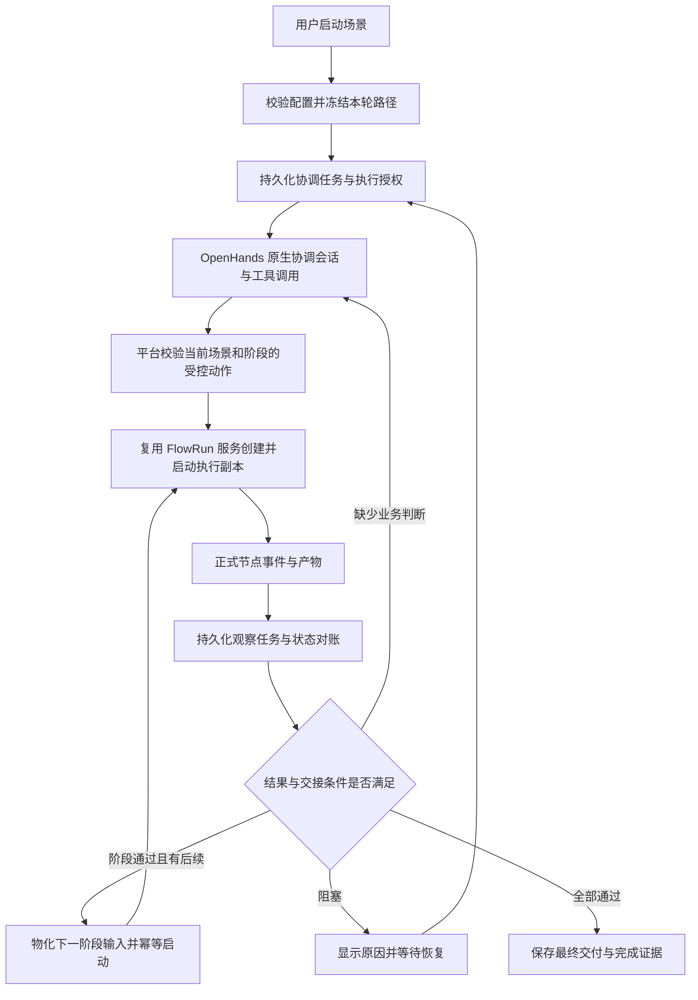

# 场景空间：使用链路、实现现状与能力缺口

核对日期：2026-10-28。源码基线：`cce531c6822a4cb43302b2f65a9a8092e7965d86`。
本文是现状审计与后续实施设计，不表示下面的待实现能力已经交付。

## 1. 场景应完成的工作

一个场景承载一个具体目标，将多个已配置流程按阶段衔接。用户完成配置并启动后，
平台能够创建独立执行副本、交接资料与产物、观察正式结果、推进下一阶段，遇到
阻塞时说明原因并提供恢复入口，最终交付有证据支撑的结果。

职责分配：

- FlowWeave 管理场景、阶段、授权、配置版本、数据交接、白名单动作和持久审计。
- OpenHands 原生 Agent 会话负责理解业务目标、分析资料和正式产物、提出结构化工具调用。
- 既有 FlowRun 编排服务负责节点执行、门禁、验收、运行快照及产物。
- 浏览器呈现服务端事实，不能依靠页面轮询驱动实际执行，也不能从聊天文本推断动作成功。

场景协调 Agent 的模型、能力和认证与阶段节点自己的执行配置分别治理。
创建一个协调会话不等于创建了执行副本，更不等于已经完成场景目标。

## 2. 当前实际可用的链路

1. 创建场景：保存名称、工作区选择、说明和目标，同时创建场景专属协调目录。
   这些基础字段创建后固定；资料可以随后添加、上传、预览、重命名和移除。
2. 添加有序阶段：前端从当前运行且可写的 FlowRun 中选择完整配置的逐步／连续记录，
   支持拖动和键盘调序。后台校验记录可用性；保存路径会把首个阶段设为 ACTIVE。
3. 保存 Agent 配置：校验供应商、模型、思考程度、能力版本及认证。
4. 点击“启动 Agent”：后台重新校验完整路径和已保存配置，在专属目录中创建
   OpenHands 原生会话并发送初始任务，然后页面打开会话。
5. 阶段卡片的“手动启动”：先复制模板，再启动当前副本；模板本身不启动。
6. 逐步节点被正式接受后，已有逻辑会尝试启动直接前驱均已接受、且已有草稿的后继节点。
   这里仍依赖正式接受；不能把节点 Agent 回复完成当作已接受。
7. 当前执行 FlowRun COMPLETED 后，回写当前阶段 COMPLETED，并将下一阶段设为 ACTIVE；
   最后阶段完成时把 Case 设为 COMPLETED。当前执行被取消时将 Case 设为 PAUSED。

当前断点：第 4 步不保证第 5 步自动发生；第 7 步只改变下一阶段的状态，不会自动
创建并启动它的执行副本。第 6 步是单个阶段内部的局部推进，不能代替跨阶段协调。

## 3. 前后端能力对应与差距

| 环节 | 前端现状 | 后台现状 | 后续需要 |
| --- | --- | --- | --- |
| 基础配置 | 场景信息、资料、Agent 配置入口已存在 | 基础字段不可变、资料安全边界、版本锁、用户隔离已存在 | 汇总可定位的配置问题；保留现有不可变边界 |
| 路径配置 | 可添加、排序、移除完整配置记录 | 模板绑定与当前执行副本分离 | 冻结本轮路径及模板版本，限制已执行部分的调序；未来变更走显式版本 |
| 开始执行 | 主动作是“启动 Agent”，另有阶段“手动启动” | 会话 bootstrap、复制、启动是分开的调用 | 统一“启动场景”命令和 readiness；首阶段受控启动不依赖人工再点一次 |
| Agent 操作 | 通用会话工作台，未见场景操作结果专用视图 | 有 binding 范围解析、plan、suggestion API | 默认装配正式原生 Tool／MCP／Plugin 能力、受限调用身份和结果事件；不能仅靠初始提示词 |
| 观察与回访 | 当前场景每 3 秒读取详情 | 产物生成 OBSERVE，完成／失败事件生成 REVIEW | 后台持久消费、原生会话投递、忙闲协调、失败重试；关闭页面仍工作 |
| 单阶段推进 | 展示当前节点和进度，去执行记录验收 | 逐步接受后有后继启动；连续复用既有自动编排 | 明确逐步验收策略、暂停边界和失败恢复，不绕过正式门禁 |
| 跨阶段推进 | 下一卡可显示当前阶段，但仍需手动启动 | 完成事件仅更新阶段 ACTIVE | 验证阶段结果、物化下一阶段输入、受控创建／启动一次独立副本 |
| 数据交接 | 资料入口、执行记录入口 | 阶段没有场景级输入输出映射契约 | Case 资料→阶段输入、前阶段正式产物→后阶段输入；冻结具体版本和来源 |
| 结束判定 | 阶段数与完成标签 | FlowRun COMPLETED 直接推动阶段／场景完成 | 明确业务验收条件；处理强制完成、跳过、取消节点等不能等同业务成功的情况 |
| 异常处理 | 通用错误；操作记录在次要面板 | 有失败码、retry API和部分修复动作 | 阻塞原因与可执行恢复入口；补齐动作分发、重试和当前执行身份切换 |
| 暂停与终止 | 无完整场景级暂停／继续／终止闭环 | 有 PAUSED 状态，多个动作只拦终态 | 定义暂停推进与停止当前执行的区别，所有入口服从同一服务端状态机 |
| 运行概览 | 路径卡片占主体，但会话单独打开 | 列表／详情携带阶段执行及全部审计 | 轻量列表、按需详情、阶段结果摘要、分页审计；主路径中直接呈现阻塞 |

## 4. 已定位的关键实现问题

### 4.1 协调会话缺少默认能力与事件回访闭环

`create_case_control_conversation` 只传入用户选择的 capability_version_ids 和初始任务；
当前仓库内未找到为 Case 自动装配受控操作工具的注册／配置链路。CLI 有通用 API
请求能力，但没有专用 Case 命令，也不能据此证明每个 Case Runtime 都具备正确工具、
认证和当前 binding 的最小授权。外部人为配置的能力不在本次本地取证范围内。

`project_case_observations` 和 `project_flow_run_event` 会创建 CaseAgentTask，
但后台 HANDLERS 中没有 Case 消费器，仓库内也未找到这些任务从 PENDING 到
RUNNING／SUCCEEDED 的处理链。case.toml 投影阶段与计划摘要，没有把这些任务和
产物证据完整投递到协调会话。Agent 首轮结束后，不能保证被正式新结果再次唤醒。

### 4.2 跨阶段只回写状态，没有启动下一阶段

`reconcile_case_execution_state` 把下一阶段置为 ACTIVE，但不调用副本创建／启动。
隔离诊断验证：阶段一完成后阶段二为 ACTIVE，current_execution_flow_run_id 仍为空，
启动调用次数为零。它提供状态投影，不是完整跨阶段调度。

### 4.3 启动失败重试可能误报成功

`start_case_stage_execution` 发现同 stage/run 的既有 proposal 后直接返回，未区分其
FAILED 状态；`execute_case_control_plan` 取得返回值后直接把计划设为 SUCCEEDED。

隔离诊断复现：已有 FAILED 的 START_STAGE_EXECUTION 时，新 START_EXECUTION 计划
最终为 SUCCEEDED，其 result.decision.state 却为 FAILED，原 FlowRun 保持 DRAFT，
实际 start_automatic_run 调用次数为零。单纯创建 retry plan 不能解决这个问题。

需要统一“命令受理、动作成功、运行开始、业务完成”的成功语义，重试使用新的可追溯
尝试，并按既有运行事实确认效果，不能把返回了响应当作成功。

### 4.4 暂停尚未成为全局执行门禁

`advance_case_stepwise_execution` 以及多个受控动作只排除 COMPLETED／ARCHIVED，
没有拒绝 PAUSED。隔离诊断复现：Case PAUSED、阶段 ACTIVE、前驱 ACCEPTED 时仍
创建并尝试分发后继启动计划。

另外，当前取消执行会把 Case 置为 PAUSED，但被 CANCELLED 的 FlowRun 是终态，
不能通过把场景状态改回 ACTIVE 来恢复原执行。必须分别定义“停止自动推进”、
“中断原生会话”和“终止本轮执行”的作用及恢复方式。

### 4.5 动作声明、API 与分发能力不完全一致

- CaseControlPlan 模型声明了 RERUN_STEPWISE_NODE／REVISE_UNSTARTED_RUNTIME。
- API 写入允许 RERUN_STEPWISE_NODE，但 plan dispatcher 尚未分发它；
  REVISE_UNSTARTED_RUNTIME 也没有对应的完整外部写入与分发路径。
- 独立 decision 分支可以复制逐步节点和连续运行草稿，但不是完整的修复后再次启动闭环。
- 连续运行复制只增加 CaseFlowRun 关联，没有自动替换阶段的 current_execution_flow_run_id；
  后续当前执行校验会限制操作新副本，需要显式受控的切换与历史保留设计。
- suggestion 路径只创建计划，既不自动执行，也不自动完成下一步决策；目前还拒绝
  通过 suggestion 请求逐步后继与重跑，不能把枚举中的动作都视为 Agent 可用能力。

### 4.6 顺序、成功条件与恢复可靠性需要收口

- 当前阶段顺序可在未终结 Case 中调整；缺少已执行阶段冻结和运行中变更版本的统一规则。
- 手动阶段状态接口允许直接指定状态，不能作为未来自动推进的可信完成证据。
- FlowRun 的 COMPLETED 包括人工结束等语义，不能直接证明业务目标已满足。
- ControlPlan 有状态及幂等键，但尚未绑定后台任务租约；多次 finish 跨越副本创建、启动和
  结果回写，需验证并修复中途崩溃、并发分发及响应不确定时的恢复，不应声称整条动作原子。
- OBSERVE／REVIEW 的去重键还没有贯通到正式 Agent 消息／工具调用和最终决策的关联链。

## 5. 推荐的用户交互

### 配置

1. 新建时明确目标、说明和工作区；这些字段随后保持固定，资料在创建成功后管理。
2. 按顺序添加现有完整模板。每个阶段补充阶段目标、所需输入、预期输出和通过条件。
   阶段间通过字段映射引用正式产物，不要求用户手工复制前一阶段的文件地址。
3. 保存协调 Agent 配置；阶段节点仍使用各自草稿中的模型、能力与认证，不被协调模型覆盖。
4. 页面汇总 readiness：配置缺失、模板过期、输入未满足、授权不可用等均能定位至具体项。
   尚未实现完整闭环前，保留“启动 Agent”的真实含义，不能只改按钮名称承诺自动执行。

### 运行

完整闭环交付后，主动作统一为“启动场景”；“打开 Agent”作为随时可用的辅助入口。
一次启动应有服务端持久状态和幂等身份，并实际触发首阶段，而不只是导航至聊天。

路径继续是视觉主体，每张卡片展示：当前阶段状态、当前节点、运行进度、最近结果、
阻塞原因和该状态允许的动作。输入／结果按需展开，流程模板与执行历史保持不同入口。
协调会话用于提问、解释决策和补充业务指令；操作记录仍是次要审计，不能当作会话消息。

### 暂停、接管与收尾

- “暂停推进”停止新节点／阶段的自动分发；当前运行如何收口必须明确显示，不假装已经停止。
- “继续”在重新检查当前执行、门禁与输入后恢复调度，不重复创建副本。
- “终止本轮”通过既有正式取消服务作用于当前执行，并保留历史；再次执行创建新的可追溯尝试。
- 缺少信息、权限或业务条件时进入明确阻塞态，展示原因与处理入口。
- 重试有次数／时限和成本预算，正常白名单动作可自主执行；不额外增加所有动作人工审批。
- 全阶段通过后展示结果摘要、正式交付物和验收证据，而不是只显示“已完成”。

## 6. 推荐的后台目标链路

这是待实现的目标图。确定性的复制、就绪后推进和状态对账由平台治理；需要业务判断
时才唤醒 Agent。不得为简单下一阶段启动制造不必要的模型轮次。

实现约束：

- 原生 Agent 执行、消息、工具、MCP／Plugin、会话状态继续消费固定 OpenHands 类型、路由和事件。
  本次取证 source lock 固定 SDK commit `73e3cd8e4d74ff30c9ed794baf72d977800509d7`，
  已确认正式 ToolDefinition、MCPConfig、Plugin 及消息提交入口存在；具体能力接入需单独契约验证。
- Case 工具应是受治理业务操作入口，底层调用既有平台 API；不解析 assistant 文本为控制 JSON，
  不另造 Agent 执行器，不给 Runtime 注入整套管理员浏览器登录凭据。
- 调用身份由服务端绑定到 owner、Case、binding 和当前阶段；模型不能自行扩大目标到其他场景、
  模板或历史执行。能力版本、digest 和运行快照可追溯，明文 Secret 不进入持久 Runtime 配置。
- 复用 BackgroundTask 的用户归属、租约、重试和过期恢复；CaseAgentTask 是业务观察投影，
  不能因为名字含 Task 就当成已经被 Worker 执行。
- 事件按正式 id／来源引用去重，投递使用稳定提交身份并处理结果不确定；任务至少一次投递，
  以幂等效果和正式事件对账实现不重复执行，不承诺网络“恰好一次”。
- 跨阶段必须从通过验收的具体 artifact version 解析输入，记录哈希和来源；跨 FlowRun 的文件
  通过既有受管产物复制／绑定机制交接，不假设协调目录或两阶段工作目录天然共享。
- 状态迁移、执行副本身份与下一步任务的持久化必须可恢复；文件投影和 memory.md 只作软上下文，
  数据库与正式 FlowRun／OpenHands 事实决定执行状态。

## 7. 后续实施顺序与验收边界

以下为候选切片，均未实施，不改动现有 FR 任务状态；每片进入实现前再细化接口及迁移。

| 顺序 | 切片 | 依赖 | 可独立验收的结果 |
| --- | --- | --- | --- |
| 1 | 统一动作结果、重试与暂停门禁 | 无 | 失败决策不能使上层成功；暂停后任何入口不得自动启动后继；旧失败可恢复且不重复执行 |
| 2 | 场景生命周期与统一 readiness／start | 1 | 配置与实际执行状态分离；启动有服务端命令身份；首阶段开始或给出准确阻塞原因 |
| 3 | 阶段输入输出与通过条件 | 2 | 资料／前阶段正式输出可映射到后阶段；版本冻结；失败／人工结束不能误判业务成功 |
| 4 | 正式 Case 工具与 binding 范围授权 | 1、2 | 固定能力可由 OpenHands 原生调用，当前阶段授权通过，跨场景／模板／历史目标均拒绝 |
| 5 | 持久化观察消费与会话回访 | 4 | OBSERVE／REVIEW 可完成；Agent 运行中合并新事实、空闲时正式唤醒；重复事件不重复投递 |
| 6 | 跨阶段自动驱动 | 3、5 | 阶段一通过后自动物化并启动阶段二；浏览器关闭和 Worker 重启后仍可推进 |
| 7 | 异常恢复与修复动作补齐 | 1、6 | 节点重跑、未启动修订、连续复制后切换可追溯；不改旧执行和模板，重试有界 |
| 8 | 前端场景执行工作台 | 2–7 的接口 | 启动／暂停／继续／终止、阻塞定位、结果查看与后台状态一致，主路径保持视觉重心 |
| 9 | 真实闭环与故障验收 | 1–8 | 混合逐步／连续三阶段完成、事件重放、租约恢复、越权和人工接管均有可复现证据 |

前端可逐片跟随接口交付，不必等到第 8 片才开始；第 8 片负责最终统一体验。
候选切片不是并行开发授权，也不表示已自动开始后续实现。

最小完整演示：收集材料 → 分析形成结构化结果 → 基于该结果执行并交付。
必须验证第二／三阶段实际读取本轮前阶段的正式产物，而不是模板历史输入。
逐步模式保留产品确定的正式验收点，混合路径不应声称无人工参与即可完成。
若未来要求逐步模式自主验收，需另行定义业务策略并仍复用正式验收与门禁接口。

## 8. 核对依据与验证范围

源码入口：

- `apps/web/src/pages/CasesPage.tsx`：路径配置、手动启动、启动会话、详情轮询与操作记录。
- `apps/web/src/pages/CaseSessionPage.tsx`：协调会话宿主及 Case／binding 对应校验。
- `services/platform/src/flowweave/modules/cases/application/service.py`：配置、作用域、
  模板复制、启动、观察投影、状态回写、plan／decision 与重试。
- `services/platform/src/flowweave/modules/cases/infrastructure/models.py`、
  `services/platform/src/flowweave/shared/schemas.py`：阶段、执行绑定及动作契约。
- `services/platform/src/flowweave/modules/tasks/application/handlers.py`：Worker 实际消费者。
- `services/platform/src/flowweave/modules/orchestration/application/service.py`：正式事件、
  产物投影、接受节点后的局部推进、模板复制与完成语义。
- `services/platform/src/flowweave/modules/agent_workspaces/application/work_directories.py`：
  case.toml 与 memory.md 软上下文投影。

本次既有 Case 配置和 API 定向回归：37 项通过，1 项失败。失败的
`test_control_binding_plan_is_limited_to_its_active_case_stage` 使用未绑定完整模板的
旧夹具创建协调会话，被当前 CASE_PATH_INCOMPLETE 门禁提前拒绝；这使该用例
未走到 binding 授权断言，必须更新夹具后再验，不能声称本轮已通过该项安全测试。

另有三项一次性 SQLite 诊断通过，分别复现下一阶段只变 ACTIVE、不启动；失败启动
决策导致上层计划 SUCCEEDED；PAUSED Case 仍分发逐步后继。诊断中的编排动作使用
替身，说明控制逻辑行为，不代表真实 Runtime 执行；临时脚本放在仓库根 `.tmp/`。
未调用真实模型、未连接或修改服务器。本次仅整理设计，未修改或部署应用代码。
